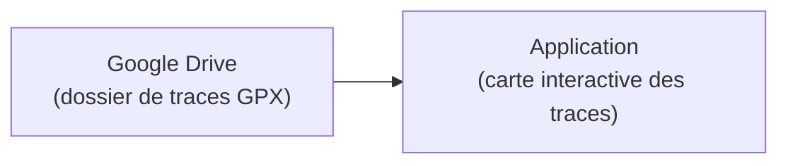

# Caractéristiques du projet

Fichier de référence **générique** du projet : ce qu'il fait et comment les pièces s'enchaînent. Il est lu **par mots-clés** (jamais en
entier) par la recette ; les intitulés de section ci-dessous sont stables.

## Ce que fait le projet

Un site statique affiche sur une carte interactive les traces GPX déposées dans un dossier Google Drive, et permet de les filtrer (catégorie, distance
des parcours) et d'en télécharger le fichier GPX.

---

## Architecture

