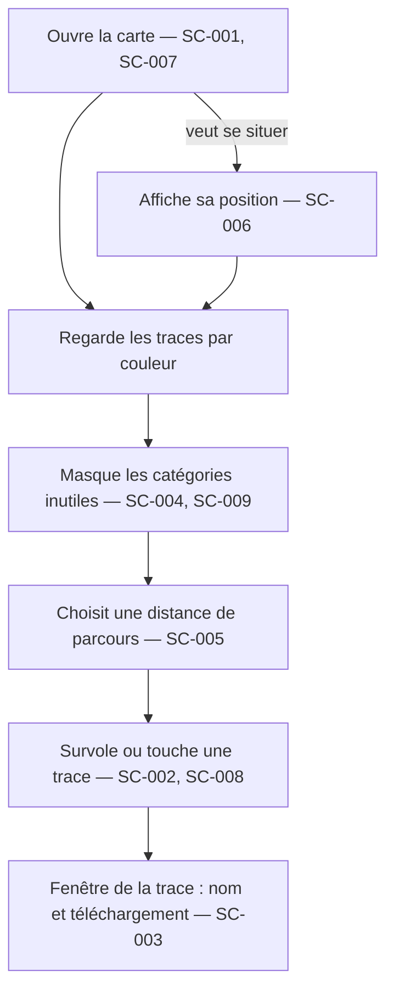
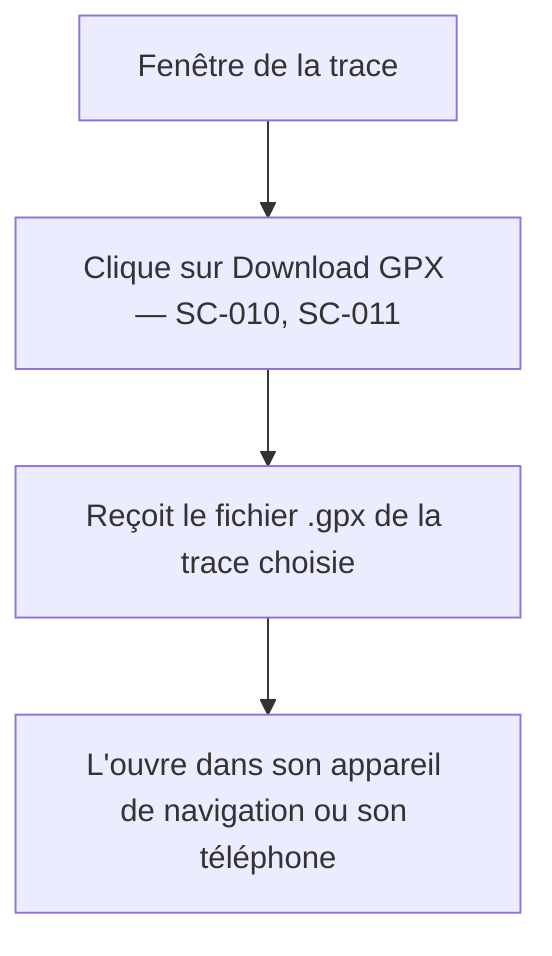
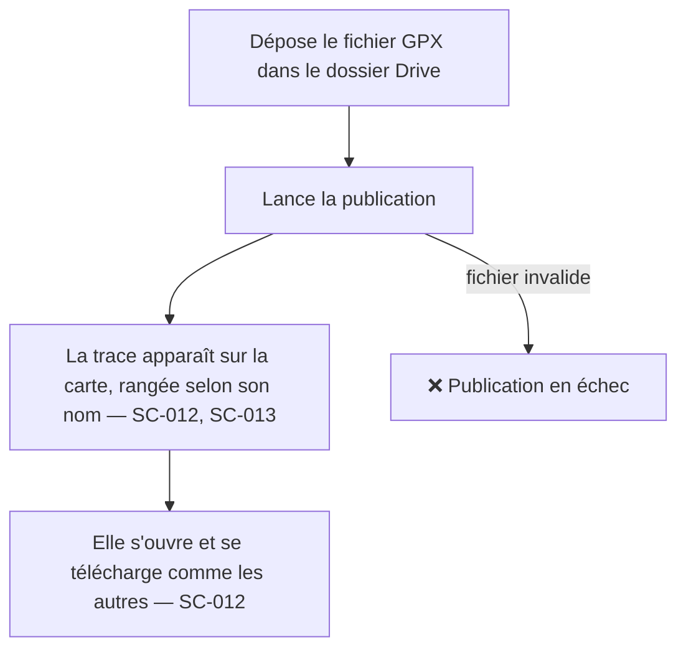

# Parcours utilisateurs — Guide fonctionnel Front

Schémas des parcours utilisateur du produit. Chaque nœud représente une page ou une décision réellement
rencontrée par l'utilisateur ; les branches `❌` sont des erreurs normales qu'il peut rencontrer, pas des cas de
test. Les codes `SC-XXX` en annotation renvoient au détail technique dans `config/front/scenarios.md`.

**Conventions**
- Un parcours = le chemin d'un utilisateur, pas une checklist de recette. Pas de journal de recette (dates, statuts d'exécution) dans ce document.
- Avant d'ajouter un parcours, vérifier qu'un parcours existant ne peut pas être enrichi.
- Pas de nom de personne, d'URL ni de donnée réelle : variantes ou sites désignés par des noms neutres.
- Légende de la matrice : ✅ activé · ❌ non activé (fonctionnalité présente) · — non documenté / non applicable · ⚠️ partiel

---

## 1. Fonctionnalités du produit

| Catégorie | Fonctionnalité | Front | Back-office |
|---|---|---|---|
| Carte | Afficher toutes les traces sur une carte interactive | ✅ | — |
| Carte | Survoler (souris) ou toucher une trace pour en voir le nom | ✅ | — |
| Carte | Afficher et masquer sa position GPS | ✅ | — |
| Filtres | Filtrer les traces par catégorie | ✅ | — |
| Filtres | Filtrer les parcours par distance | ✅ | — |
| Téléchargement | Télécharger le fichier GPX d'une trace | ✅ | — |
| Publication | Rendre visible une trace déposée sur le Drive | ✅ | — |

---

## 2. Parcours

### 2.1 Trouver une trace qui convient

Pour : une personne qui prépare une sortie à pied ou à vélo, sur ordinateur ou sur téléphone.

### 2.2 Emporter la trace

Pour : la même personne, une fois sa trace choisie.

### 2.3 Publier une nouvelle trace

Pour : la personne qui entretient les traces.

